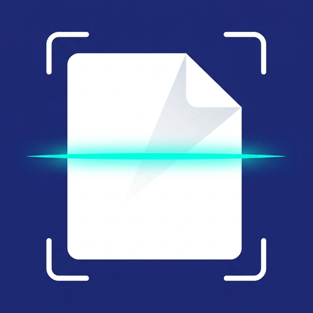
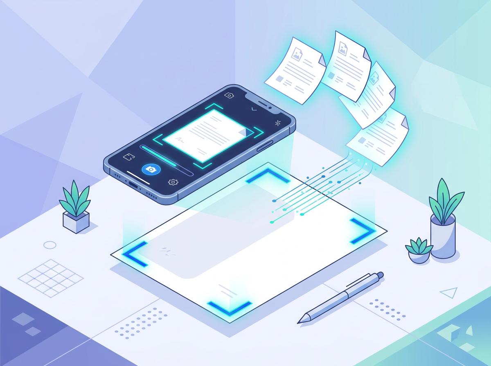
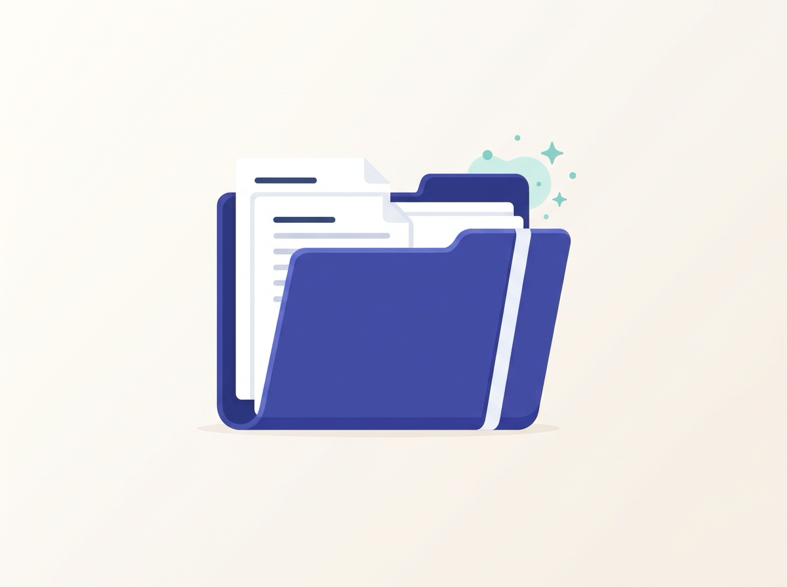

# 📄 ScanMate - Smart Document Scanner & OCR PDF Creator

<p align="center">
  
</p>

<p align="center">
  <b>A modern, privacy-first Android application for auto document edge detection, on-device OCR text extraction, image capture, and instant multi-page PDF generation.</b>
</p>

<p align="center">
  <a href="https://github.com/omsoni21/scanmate/releases/latest/download/app-release.apk">
    
  </a>
</p>

<p align="center">
  
  
  
  
  
</p>

---

## 📥 Download App (APK)

Get the latest ready-to-install Android APK directly:

| Build Type | Download Link | File Size | Description |
| :--- | :--- | :--- | :--- |
| **🚀 Release APK (Recommended)** | [**Download app-release.apk** 📥](https://github.com/omsoni21/scanmate/releases/latest/download/app-release.apk) | ~25 MB | Optimized production build |
| **🧪 Debug APK** | [**Download app-debug.apk** 📥](https://raw.githubusercontent.com/omsoni21/scanmate/main/app/build/outputs/apk/debug/app-debug.apk) | ~30 MB | Testing build with logs |

> 💡 **Tip:** After downloading on your Android device, enable *"Install from Unknown Sources"* if prompted.

---

## 📸 App Screenshots & Preview

<div align="center">

| Camera & Edge Scan | Crop & Perspective | ML Kit OCR Text | Multi-Page PDF Editor | Document Library |
|:---:|:---:|:---:|:---:|:---:|
|  |  |  |  |  |

</div>

> 📌 *Note: Place your screenshot PNG files in `docs/screenshots/` folder to display them on GitHub.*

---

## 🌟 Key Features

- 🔍 **Auto Document Edge & Shape Detection**
  - Real-time automatic document boundary detection using edge algorithms.
  - Perspective transformation & 4-point quadrilateral cropping.

- 📝 **On-Device OCR Text Extraction**
  - High-accuracy text recognition powered by **Google ML Kit Text Recognition**.
  - 100% offline text extraction — no internet required, protecting privacy.
  - Copy, edit, or share extracted text instantly.

- 📸 **Intelligent Camera (CameraX)**
  - Real-time live preview with grid overlay, flash controls, and pinch-to-zoom.
  - Auto-focus metering on tap.
  - Import existing images directly from your device gallery.

- 🎨 **Multi-Page Image Editor & Filters**
  - Page reordering with drag-and-drop.
  - Image enhancements: Magic Color, Grayscale, B&W, Contrast & Brightness adjustment.
  - Rotation (90°, 180°, 270°) and flip tools.

- 📄 **High-Quality PDF Generator & Viewer**
  - Convert multi-page scanned pages into high-resolution PDF files.
  - Page orientation (Portrait/Landscape), custom paper sizes (A4, Letter, Auto).
  - PDF compression & optional password encryption via PDFBox.
  - Built-in PDF reader with pinch-to-zoom.

- 📂 **Folder & Vault Management**
  - Categorize scans into custom folders (Work, Personal, Receipts, Education).
  - Search documents by title, tag, or extracted OCR text.
  - Storage statistics & battery-saver mode support.

---

## 🛠️ Tech Stack & Architecture

- **Language:** Kotlin 2.0+
- **Architecture:** MVVM + Repository Pattern + Clean Architecture
- **UI:** Jetpack Compose, Material 3, Navigation Compose
- **Camera API:** AndroidX CameraX (Preview, ImageCapture, ImageAnalysis)
- **OCR Engine:** Google ML Kit Text Recognition (Latin)
- **PDF Engines:** Native `android.graphics.pdf.PdfDocument` & Apache `PDFBox-Android`
- **Database & Storage:** Room Database + DataStore Preferences + Android Internal File Storage
- **Dependency Injection:** Hilt (Dagger)
- **Asynchronous Work:** Kotlin Coroutines & Flow

---

## 📁 Directory Structure

```text
scanmate/
 ├── app/
 │    ├── src/main/java/com/example/
 │    │    ├── data/          # Room DB, DAOs, OCR Engine, PDF Generator, Storage
 │    │    ├── di/            # Hilt Dependency Injection Modules
 │    │    ├── domain/        # Domain Models & Business Logic
 │    │    └── ui/            # Jetpack Compose Screens, ViewModels & Components
 │    │         ├── scanner/  # CameraX Scanner Screen
 │    │         ├── editor/   # Crop & Page Enhancement Screens
 │    │         ├── viewer/   # PDF Viewer & Reader
 │    │         ├── folders/  # Folder Management
 │    │         └── theme/    # Material 3 Color Schemes & Typography
 ├── docs/
 │    └── screenshots/        # Application Screenshots
 └── README.md
```

---

## 📄 License
This project is licensed under the **MIT License** - see the [LICENSE](LICENSE) file for details.

---

<p align="center">
  Made with ❤️ for privacy-focused document scanning & fast PDF creation.
</p>
